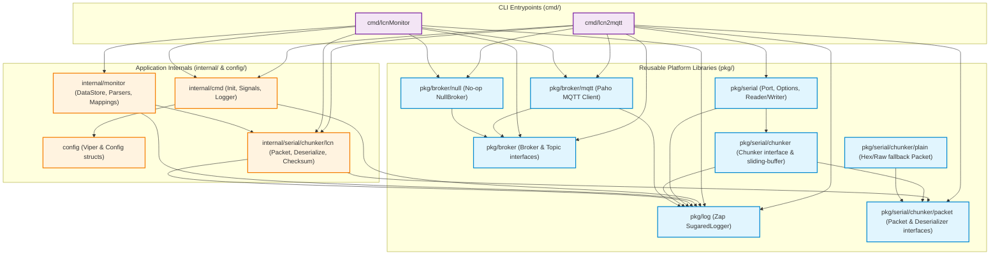
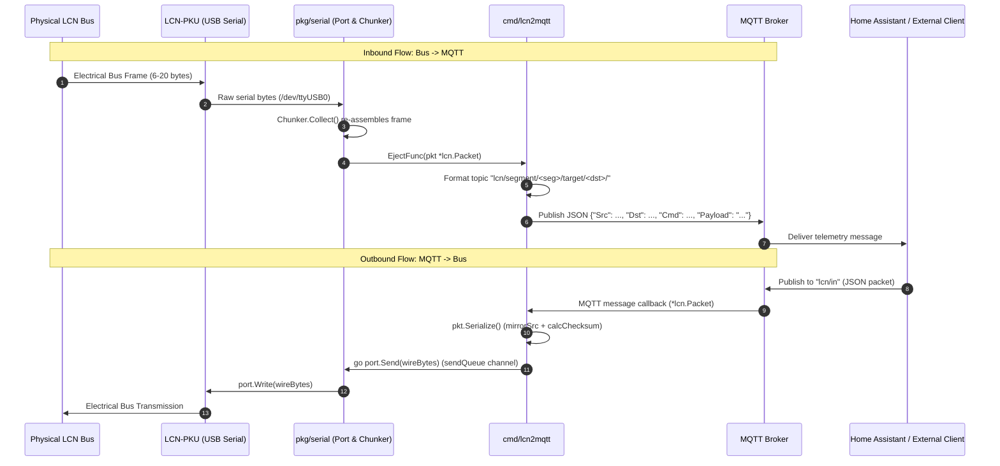
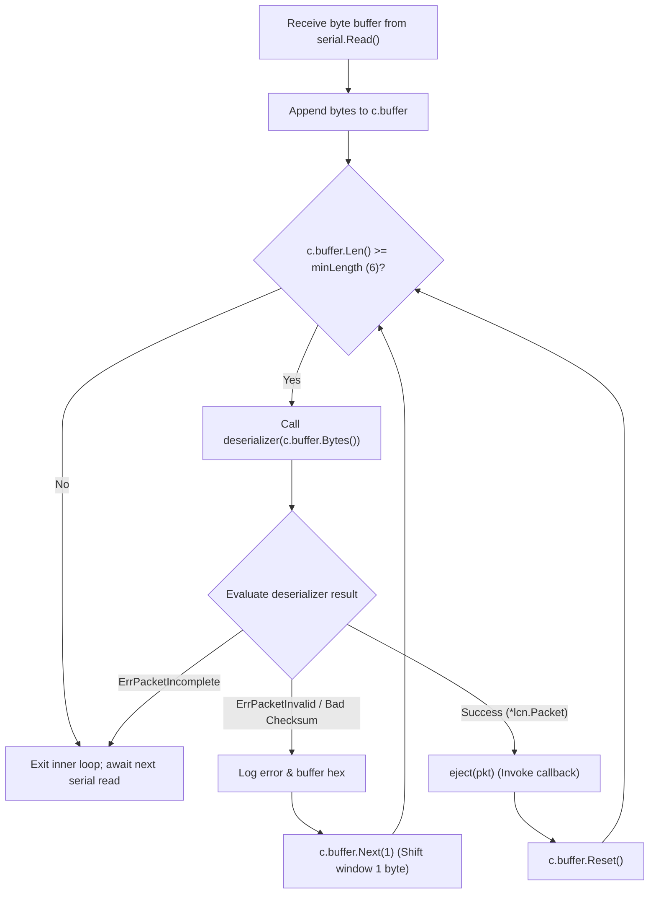

# reverseLCN System Architecture

This document describes the architectural layout, package dependency graph, bidirectional communication flows, sliding-window chunker resynchronization mechanics, and container build strategy of `reverseLCN`.

---

## Dual-Binary Package DAG

The repository compiles two independent CLI binaries from [`cmd/`](../cmd):
1. `lcn2mqtt`: Production USB serial <-> MQTT gateway bridge.
2. `lcnMonitor`: Diagnostic bus observer and packet decoding subscriber.

The architecture strictly enforces package boundaries: generic utility packages located under [`pkg/`](../pkg) never import application packages under [`cmd/`](../cmd), [`config/`](../config), or [`internal/`](../internal).



---

## Bidirectional Bridge Sequence

[`cmd/lcn2mqtt`](../cmd/lcn2mqtt/lcn2mqtt.go) mediates between the physical serial connection (`LCN-PKU`) and an MQTT broker. Communication is fully bidirectional:

### 1. Bus -> MQTT (Inbound Telemetry)
The physical bus transmits electrical pulses read by the PKU USB adapter. Incoming bytes are chunked, validated, deserialized into an [`lcn.Packet`](../internal/serial/chunker/lcn/lcn.go#L34), and published as JSON to `lcn/segment/<seg>/target/<dst>/`.

### 2. MQTT -> Bus (Outbound Commands)
An external client or smart-home controller publishes an LCN packet JSON payload to `lcn/in`. The bridge receives the message, unmarshals the JSON into an `lcn.Packet`, computes the rotated-sum checksum and mirrored source byte, and queues the binary buffer to the serial writer.



---

## Sliding-Window Chunker Resynchronization

Because serial connections over USB can experience noise, frame fragmentation, or byte loss across OS `read()` boundaries, [`pkg/serial/chunker/chunker.go`](../pkg/serial/chunker/chunker.go) implements a sliding-window resynchronization state machine.

### State Transitions

1. **Ingest**: Raw bytes read from the serial port are appended directly to the internal `bytes.Buffer`.
2. **Length Guard**: If `buffer.Len() < minLength` (where `minLength = 6` for LCN), the chunker yields back to the serial reader to await more data.
3. **Speculative Deserialization**: The chunker presents current buffer bytes to the registered [`packet.Deserializer`](../pkg/serial/chunker/packet/packet.go#L16).
4. **Resolution**:
   - **`ErrPacketIncomplete`**: The packet header specifies a larger length than currently buffered (e.g. `Info` specifies length 12 or 20, but only 8 bytes have arrived). The loop breaks without consuming bytes and waits for the next OS read (`continue read_loop`).
   - **`ErrPacketInvalid` or Checksum Error**: The buffer contains corrupt framing, an illegal length code, or an invalid checksum. The chunker executes `search()` (`buffer.Next(1)`), which **discards exactly 1 byte** from the head of the buffer, shifting the window forward to re-test the subsequent byte as a potential frame start.
   - **Success**: A clean, checksum-verified packet is assembled. The chunker invokes [`eject(pkt)`](../pkg/serial/chunker/chunker.go#L57) and calls `reset()` (`buffer.Reset()`), clearing the consumed frame and preparing for the next sequence.



---

## Container Build Architecture (`FROM scratch`)

The container images for `lcn2mqtt` are defined in [`Dockerfile`](../Dockerfile) and [`build/lcn2mqtt/Dockerfile`](../build/lcn2mqtt/Dockerfile). The build uses a strict multi-stage workflow:

### Stage 1: Static Builder (`golang:1.27-alpine`)
- Runs natively on `$BUILDPLATFORM` (`FROM --platform=$BUILDPLATFORM golang:1.27-alpine AS builder`) and cross-compiles for `$TARGETOS`/`$TARGETARCH`/`$TARGETVARIANT` (`linux/amd64`, `linux/arm64`, `linux/arm/v7`, `linux/arm/v6`).
- Installs minimal toolchain requirements (`ca-certificates`, `tzdata`, `musl-utils`) and creates an unprivileged user (`appuser`, `UID=10001`).
- Compiles a fully static binary with Go build cache mounting:
  ```bash
  CGO_ENABLED=0 GOOS=${TARGETOS:-linux} GOARCH=${TARGETARCH} GOARM=${TARGETVARIANT#v} \
  go build -v -ldflags "-w -s -X main.Version=$APP_VERSION -extldflags '-static'" -o /dist/lcn2mqtt ./cmd/lcn2mqtt
  ```
- Uses `ldd` and `xargs` to verify and resolve any runtime shared library requirements into `/dist`.

### Stage 2: Runtime (`FROM scratch`)
- Copies time zone data from `/usr/share/zoneinfo`.
- Copies trusted SSL/TLS root certificates from `/etc/ssl/certs/ca-certificates.crt` (required for TLS MQTT broker connections).
- Copies `/etc/passwd` and `/etc/group` from builder and switches to `USER appuser:appuser` (`10001:10001`).
- Copies the static binary `/dist/lcn2mqtt` into root `/`.
- Copies default configuration from `/build/config/config.yml` into `/config/`.
- Configures `ENTRYPOINT ["/lcn2mqtt"]`.

This produces a zero-footprint, hardened image containing no shell, package manager, or unnecessary OS binaries, minimizing attack surface and eliminating container base-image CVEs.

### Helm Chart Packaging (`helm/charts/reverselcn`)
- [`helm/charts/reverselcn/`](../helm/charts/reverselcn/) packages `lcn2mqtt` as a non-root, privilege-dropped Kubernetes `DaemonSet` (`runAsNonRoot: true`, `runAsUser: 10001`, `supplementalGroups: [20]` for `dialout`, `allowPrivilegeEscalation: false`, `readOnlyRootFilesystem: true`, `capabilities.drop: ["ALL"]`) using `updateStrategy.rollingUpdate` (`maxSurge: 0, maxUnavailable: 1`) and mounting only the serial character device (`type: CharDevice`).
- Published automatically to GitHub Pages via [`.github/workflows/release-chart.yml`](../.github/workflows/release-chart.yml).
